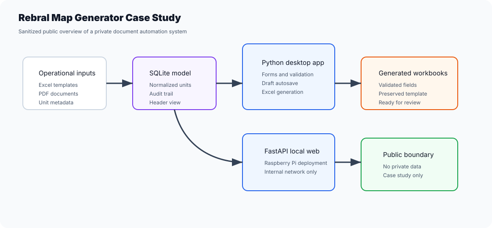
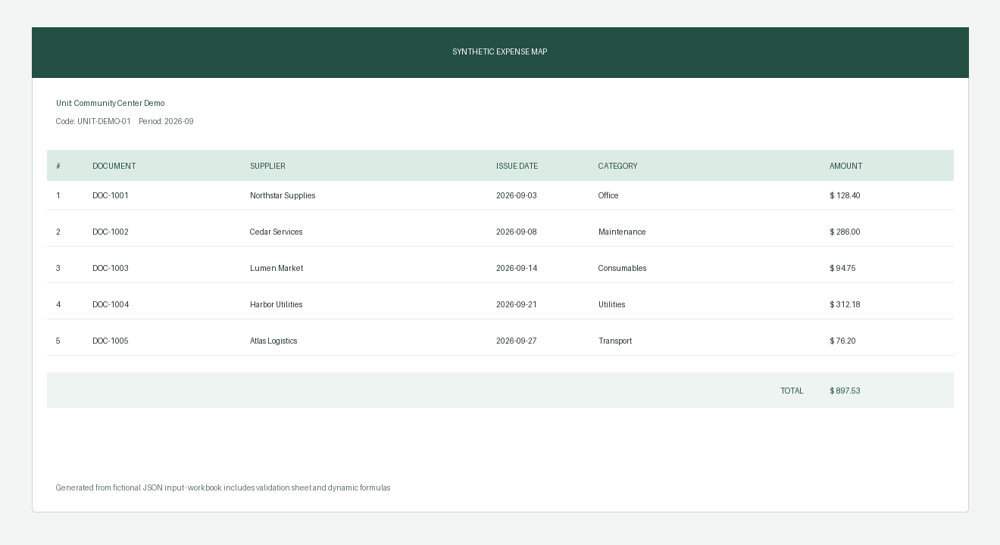

# Rebral Map Generator Case Study

[English / README principal](README.md) · Português (Brasil)

Estudo de caso público, sem dados sensíveis, de um sistema privado de automação de documentos em Python.





O repositório real permanece privado porque contém documentos operacionais, bancos de dados, arquivos fiscais e contexto específico da organização. Este repositório público existe para apresentar o trabalho de engenharia sem expor dados privados.

## O que o sistema privado faz

- Organiza metadados recorrentes de unidades em SQLite.
- Preenche modelos oficiais de planilhas sem quebrar o layout.
- Extrai dados de PDFs com alternativa de OCR para arquivos digitalizados.
- Oferece um fluxo de trabalho em aplicativo desktop para revisão, validação e recuperação de rascunhos.
- Inclui uma versão web local em FastAPI para uso em Raspberry Pi ou rede interna.
- Gera planilhas para revisão humana e entrega.

## O que este repositório público contém

- Um gerador executável de JSON para XLSX com linhas e fórmulas dinâmicas.
- Um exemplo sintético com cinco documentos e uma prévia visual gerada.
- Verificações automatizadas de abas, filtros, fórmulas e referências quebradas nas planilhas.
- Arquitetura sem dados sensíveis.
- Narrativa do estudo de caso.
- Limites de segurança.
- Notas sobre o que poderia ser reutilizado em uma demonstração pública genérica.
- Verificação de CI que bloqueia formatos de arquivos de dados privados.

Leia o estudo de caso completo: [docs/case-study.md](docs/case-study.md).

## Execute a demonstração pública

```bash
python -m pip install -e ".[dev]"
python -m map_demo.cli examples/synthetic-map.json outputs/demo-map.xlsx --preview outputs/demo-preview.png
pytest -q
```

As planilhas geradas continuam ignoradas pelo Git. A entrada e a prévia incluídas no repositório usam apenas
unidades, fornecedores, referências e valores inventados.
